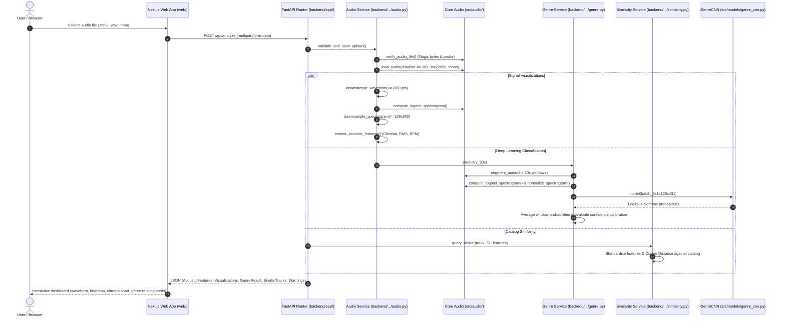
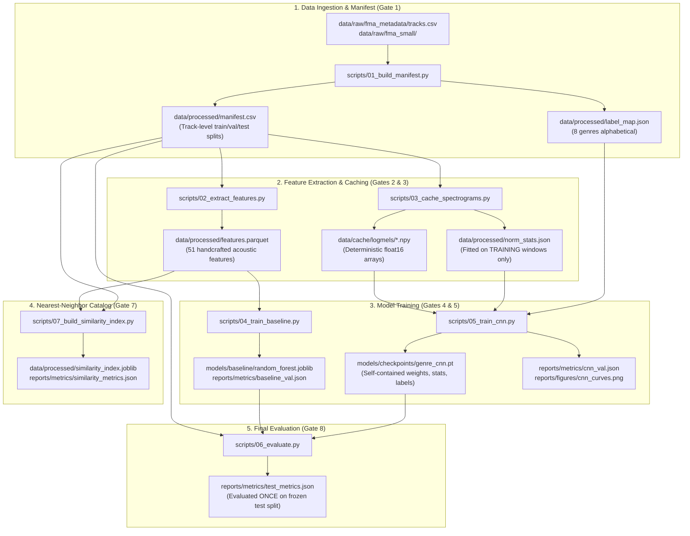

# SonicFusion 2: Architecture Audit & Restructuring Plan

> **Date:** October 21, 2026  
> **Status:** READ-ONLY AUDIT & PROPOSAL (Pending User Approval)  
> **Scope & Authority:** Based on [`docs/PLAN.md`](docs/PLAN.md) (§05, Addenda A1–A7) and [`.agent/rules/sonicfusion2.md`](.agents/rules/sonicfusion2.md).  
> **Hard Constraints Honored:** No existing files modified, moved, or deleted. All paths, commands, and references analyzed in place.

---

## 1. Current Project Structure (As-Is)

The directory structure below was dynamically inspected to depth 3 (excluding `.venv`, `node_modules`, `.next`, `.git`, `__pycache__`, `.pytest_cache`, and recursions into `data/raw` and `data/cache`):

```
Sonicfusion2/
├── .env.example
├── .gitignore
├── README.md
├── requirements.txt
├── test.wav
├── test_tone.mp3
├── agents/
│   └── rules/
│       └── sonicfusion2.md
├── backend/
│   ├── __init__.py
│   └── app/
│       ├── __init__.py
│       ├── main.py
│       ├── schemas.py
│       ├── routes/
│       │   ├── __init__.py
│       │   └── analyze.py
│       └── services/
│           ├── __init__.py
│           ├── audio.py
│           ├── genre.py
│           ├── similarity.py
│           └── tags.py
├── configs/
│   └── config.yaml
├── data/
│   ├── cache/                  # (23,982 precomputed window .npy files, git-ignored)
│   ├── downloads/
│   │   ├── fma_metadata.zip
│   │   └── fma_small.zip
│   ├── processed/
│   │   ├── features.parquet
│   │   ├── label_map.json
│   │   ├── manifest.csv
│   │   ├── manifest_full.csv
│   │   ├── norm_stats.json
│   │   └── similarity_index.joblib
│   ├── raw/                    # (8,002 audio files + metadata CSVs, git-ignored)
│   └── user_samples/
│       └── Tum Tak.mp3
├── docs/
│   ├── PLAN.md
│   └── SonicScope_AI_Complete_Implementation_Plan.pdf
├── models/
│   ├── baseline/
│   │   └── random_forest.joblib
│   ├── checkpoints/
│   │   └── genre_cnn.pt
│   └── pretrained/             # (Empty directory)
├── reports/
│   ├── figures/
│   │   ├── .gitkeep
│   │   └── pilot_cnn_2epoch_curves.png
│   ├── metrics/
│   │   ├── .gitkeep
│   │   ├── baseline_val.json
│   │   ├── data_exclusions.csv
│   │   ├── manifest_audit.json
│   │   ├── pilot_cnn_2epoch_val.json
│   │   └── similarity_metrics.json
│   └── screenshots/
│       ├── .gitkeep
│       ├── 01_upload_page.png
│       ├── 02_about_page.png
│       ├── 03_evaluation_page.png
│       ├── 04_sample_loaded.png
│       ├── 05_staged_loading.png
│       └── 06_analysis_results.png
├── scripts/
│   ├── 01_build_manifest.py
│   ├── 02_extract_features.py
│   ├── 03_cache_spectrograms.py
│   ├── 04_train_baseline.py
│   ├── 05_train_cnn.py
│   ├── 06_evaluate.py
│   ├── 07_build_similarity_index.py
│   ├── 08_smoke_test.py
│   ├── __init__.py
│   ├── predict.py
│   └── run_full_pipeline.py
├── src/
│   ├── __init__.py
│   ├── config.py
│   ├── audio/
│   │   ├── __init__.py
│   │   ├── loading.py
│   │   ├── spectrogram.py
│   │   └── validation.py
│   ├── features/
│   │   ├── __init__.py
│   │   └── extraction.py
│   └── models/
│       ├── __init__.py
│       ├── baseline.py
│       └── genre_cnn.py
├── tests/
│   ├── __init__.py
│   ├── test_audio_decode.py
│   ├── test_audio_features.py
│   ├── test_audio_regression.py
│   ├── test_backend.py
│   ├── test_baseline.py
│   ├── test_cnn.py
│   ├── test_cnn_training.py
│   ├── test_config.py
│   ├── test_manifest.py
│   └── test_similarity.py
└── web/
    ├── .env.local
    ├── .gitignore
    ├── AGENTS.md
    ├── README.md
    ├── eslint.config.mjs
    ├── next-env.d.ts
    ├── next.config.ts
    ├── package-lock.json
    ├── package.json
    ├── tsconfig.json
    ├── public/
    │   ├── file.svg
    │   ├── globe.svg
    │   ├── next.svg
    │   ├── samples/
    │   │   ├── sample_000002.mp3
    │   │   └── sample_000005.mp3
    │   ├── vercel.svg
    │   └── window.svg
    └── src/
        ├── app/
        │   ├── favicon.ico
        │   ├── globals.css
        │   ├── layout.tsx
        │   ├── page.tsx
        │   ├── about/
        │   │   └── page.tsx
        │   ├── analysis/
        │   │   └── page.tsx
        │   └── evaluation/
        │       └── page.tsx
        ├── components/
        │   ├── AudioPlayer.tsx
        │   ├── ChromaChart.tsx
        │   ├── GenreRanking.tsx
        │   ├── Navbar.tsx
        │   ├── SpectrogramHeatmap.tsx
        │   ├── StagedLoading.tsx
        │   └── WaveformChart.tsx
        ├── lib/
        │   ├── api.ts
        │   └── storage.ts
        └── types/
            └── api.ts
```

### Classification of Top-Level Files and Folders

| Top-Level Entity | Classification | Architectural Responsibility |
|---|---|---|
| `agents/` | KEEP | Agent rules and operational directives (`agents/rules/sonicfusion2.md`). |
| `backend/` | KEEP | FastAPI application handling HTTP ingestion, decode validation, and service orchestration. |
| `configs/` | KEEP | Central declarative configuration (`configs/config.yaml`). Single source of truth for hyperparameters and paths. |
| `data/` | KEEP (Git-ignored) | Data tier containing raw audio, downloads, parquet features, manifest, and window caches. |
| `docs/` | KEEP | Documentation tier containing academic specifications, blueprint PDF, and PLAN.md. |
| `models/` | KEEP (Git-ignored) | Checkpoints tier containing trained weights (`genre_cnn.pt`), baseline model, and pretrained heads. |
| `reports/` | KEEP (Tracked) | Verification tier containing evaluation metrics JSONs, confusion plots, and QA screenshots. |
| `scripts/` | KEEP | Numbered CLI pipelines (Gates 1–8) for manifest creation, feature extraction, training, and evaluation. |
| `src/` | KEEP | Core ML domain logic (audio decoders, spectrogram compute, 51-dim feature extractors, PyTorch CNN, RF baseline). |
| `tests/` | KEEP | Comprehensive test suite (81 automated test functions across 10 modules). |
| `web/` | KEEP | Next.js 16 App Router UI tier with React/TypeScript visualization components. |
| `.env.example` | KEEP | Environment configuration template for backend and frontend URLs. |
| `.gitignore` | KEEP (Needs refinement) | Root version control exclusions list. |
| `README.md` | KEEP (Needs alignment) | Project documentation, setup instructions, and evaluation summaries. |
| `requirements.txt` | KEEP | Python package dependencies specification (pinned for Python 3.13). |
| `test.wav` | DELETE-CANDIDATE | Scratch WAV audio file in root directory. Unreferenced by tests, scripts, or application. |
| `test_tone.mp3` | DELETE-CANDIDATE | Scratch MP3 audio file in root directory. Unreferenced by tests, scripts, or application. |

---

## 2. Comprehensive Inventory Table

Below is the inventory of all audited files, their architectural purpose, exact line references, recommended verdict, and migration risk:

| Path | Purpose | Referenced by (Exact Files & Lines) | Verdict | Risk |
|---|---|---|---|---|
| `test.wav` | Scratch audio fixture in root | None (0 references in code/tests) | DELETE-CANDIDATE | Low |
| `test_tone.mp3` | Scratch tone MP3 in root | None (0 references in code/tests) | DELETE-CANDIDATE | Low |
| `data/processed/manifest_full.csv` | Duplicate copy of manifest.csv | None (0 references; identical byte-for-byte to `manifest.csv`) | DELETE-CANDIDATE | Low |
| `data/downloads/fma_small.zip` | Original 7.2 GiB dataset ZIP | Download guide in `docs/PLAN.md:29,193` | DELETE-CANDIDATE (per PLAN §A3 to free disk) | Low |
| `data/downloads/fma_metadata.zip` | Original 342 MiB metadata ZIP | Download guide in `docs/PLAN.md:30,196` | DELETE-CANDIDATE (per PLAN §A3 to free disk) | Low |
| `data/user_samples/Tum Tak.mp3` | User-provided real song for manual sanity testing | `tests/test_audio_regression.py:122-125` (guarded by `pytest.skip` if missing) | KEEP (or move to test fixture folder) | Low |
| `scripts/run_full_pipeline.py` | Convenience sequential runner for scripts 02, 03, 04, 05 | None (orchestrator script; unreferenced by tests or docs) | KEEP | Low |
| `scripts/predict.py` | Single-track inference CLI | `README.md:46,173`; `docs/PLAN.md:788` | KEEP | Low |
| `scripts/06_evaluate.py` | Stub for final test split evaluation (Gate 8) | `docs/PLAN.md:260,839`; `README.md:47` | KEEP (Implement for Gate 8) | Medium |
| `backend/app/services/tags.py` | Stub for optional EffNet mood/instrument tags | `docs/PLAN.md:250` (currently 2 lines, unimported) | KEEP (Stub for post-submission extension) | Low |
| `backend/app/main.py` | FastAPI application entry point; hosts `/api/health`, `/api/models`, `/api/metrics`, `/api/catalog` | `scripts/08_smoke_test.py:27`; `tests/test_backend.py:18`; `tests/test_similarity.py:16` | KEEP (Refactor routes into `routes/` module) | Medium |
| `backend/app/routes/analyze.py` | Dedicated route module for `POST /api/analyze` | `backend/app/main.py:26,59` | KEEP | Low |
| `web/public/file.svg` | Default Next.js starter icon | None (0 references in frontend components) | DELETE-CANDIDATE | Low |
| `web/public/globe.svg` | Default Next.js starter icon | None (0 references in frontend components) | DELETE-CANDIDATE | Low |
| `web/public/next.svg` | Default Next.js starter icon | None (0 references in frontend components) | DELETE-CANDIDATE | Low |
| `web/public/vercel.svg` | Default Next.js starter icon | None (0 references in frontend components) | DELETE-CANDIDATE | Low |
| `web/public/window.svg` | Default Next.js starter icon | None (0 references in frontend components) | DELETE-CANDIDATE | Low |
| `web/AGENTS.md` | Nested AI prompt instructions in web directory | None (Workspace root rules govern development) | DELETE-CANDIDATE | Low |
| `web/README.md` | Default create-next-app README | None (Overridden by root `README.md`) | DELETE-CANDIDATE | Low |
| `web/public/samples/*.mp3` | Catalog audio samples for UI demo | `web/src/lib/api.ts:66-74`; `web/src/app/page.tsx:32-33` | KEEP (Track via Git or LFS) | Low |

---

## 3. Structural Problems & Specific Audit Findings

### 3.1 Root Directory Clutter & Generated Scratch Files
- **`test.wav` and `test_tone.mp3`**: Located directly in the repository root. Search revealed **0 references** across the entire codebase and test suite. Generated during early audio decode debugging.
- **`data/processed/manifest_full.csv`**: Exact 518,692-byte replica of `data/processed/manifest.csv`. No scripts or tests query `manifest_full.csv`.
- **`data/downloads/*.zip`**: The 7.2 GiB `fma_small.zip` and 342 MiB `fma_metadata.zip` occupy ~7.6 GiB in `data/downloads/`. Addendum A3 explicitly mandates: *"Verify each ZIP's SHA-1, extract it, then delete the ZIP"* to conserve developer disk space.
- **`scripts/run_full_pipeline.py`**: A master batch runner invoking `02_extract_features.py`, `03_cache_spectrograms.py`, `04_train_baseline.py`, and `05_train_cnn.py`. It is a legitimate utility, but not documented in `README.md` or `PLAN.md`.

### 3.2 Duplicate & Overlapping Logic Analysis
- **Audio Loading & Resampling**: Strict adherence confirmed. Both training (`scripts/03_cache_spectrograms.py`, `scripts/05_train_cnn.py`), CLI inference (`scripts/predict.py`), and backend (`backend/app/routes/analyze.py`) import identically from `src.audio.loading` (`load_audio`, `segment_audio`).
- **Log-Mel Spectrogram Generation**: All tiers import from `src.audio.spectrogram` (`compute_logmel_spectrogram`, `normalize_spectrogram`).
- **Feature Extraction**: All baseline training and similarity retrieval pipelines import canonical 51-feature extraction from `src.features.extraction` (`extract_track_features`, `FEATURE_NAMES`).
- **Model Implementations**: PyTorch CNN model is defined once in `src.models.genre_cnn.GenreCNN` and consumed by training, inference, and backend service.
- **Normalization Consistency**: Training computes mean and standard deviation across training split windows only (`data/processed/norm_stats.json`). Both CLI `predict.py` and `backend/app/services/genre.py` load these exact normalization statistics directly from the checkpoint payload.
- **Backend Service Layer vs Route Logic**: In `backend/app/routes/analyze.py`, audio loading, padding, downsampling, and acoustic feature extraction are orchestrated cleanly. However, in `backend/app/main.py`, multiple routes (`/api/health`, `/api/models`, `/api/metrics`, `/api/catalog/{track_id}`) are implemented inline in `main.py` rather than modular route files.

### 3.3 Dead Code & Unreferenced Assets
1. **Unreferenced Modules**: `backend/app/services/tags.py` is a 2-line docstring stub for post-G8 Essentia tag inference. It is unimported.
2. **Unused Frontend Assets**: Standard Next.js scaffolding SVG icons (`web/public/file.svg`, `globe.svg`, `next.svg`, `vercel.svg`, `window.svg`) are completely unreferenced.
3. **Dead Files**: `web/README.md` and `web/AGENTS.md` are boilerplate artifacts unreferenced by any build script or documentation.
4. **Config Keys Not Read in Python**:
   - `paths.fma_small_dir` (directory constructed dynamically in code from `fma_small/{tid//1000:03d}/{tid:06d}.mp3`)
   - `paths.models_dir`, `paths.reports_dir`, `paths.screenshots_dir` (subdirectories accessed directly via specific keys like `baseline_model_path`, `metrics_dir`, `figures_dir`)
   - `audio.f_min`, `audio.f_max` (defaults used directly in librosa transform functions)
   *(Note: These config keys are harmless declarations that document intent, so they must be retained per constraint not to edit `configs/config.yaml`).*

### 3.4 Hardcoded Paths & Magic Numbers
- In `scripts/01_build_manifest.py`:
  - `rel_path = f"data/raw/fma_small/{tid // 1000:03d}/{tid:06d}.mp3"` (lines 175, 302): Hardcodes `data/raw/fma_small/` relative path instead of pulling from `cfg.paths.raw_dir`.
- In `backend/app/main.py`:
  - Direct string references to `"reports/metrics/cnn_val.json"` and `"reports/metrics/baseline_val.json"` (lines 121, 122).
- In `web/src/lib/api.ts`:
  - Fallback URL `http://localhost:8000` is present if `NEXT_PUBLIC_API_BASE_URL` is omitted (good practice, but must match port).

### 3.5 Documentation vs. Implementation Mismatches
1. **README Script Tree vs Reality**:
   - `README.md:46` lists `predict.py` as `scripts/predict.py (Gate 6)`.
   - `docs/PLAN.md:255-262` lists numbered scripts `01` through `08` without `predict.py` in the section 05 tree, although single-file inference is mandated in §09/§13.
2. **Test Count Discrepancy**:
   - `README.md:61` states: `tests/ # Pytest test suite (51 unit and integration tests)`.
   - The actual test suite contains **81 test functions** across 10 modules (all currently passing).
3. **Gate Status in Documentation**:
   - Gate 1 through Gate 7 are implemented. Gate 8 (`scripts/06_evaluate.py`) is currently an unexecuted stub waiting for final checkpoint freeze on the held-out test split (strictly following PLAN §A5).

### 3.6 Git and `.gitignore` Review
- **Issue 1: Sample Audio Exclusion**: The rule `*.mp3` in `.gitignore:13` ignores `web/public/samples/sample_000002.mp3` and `web/public/samples/sample_000005.mp3`. Because these are needed by the frontend UI demo, they should be explicitly allowed via `!web/public/samples/*.mp3`.
- **Issue 2: Reports Tracking**: Rule `.gitignore:7` (`data/`) and `.gitignore:8` (`models/`) correctly ignore heavy training data and weights. Crucially, `reports/metrics/*.json` and `reports/figures/*.png` are NOT ignored and will be committed as required by the specification.
- **Issue 3: Dirty Working Tree**: Currently, `.gitignore` has an uncommitted modification (removal of PowerShell echo artifact), while `backend/`, `configs/`, `docs/`, `reports/`, `scripts/`, `src/`, `tests/`, and `web/` are currently untracked because no commit has been made since project setup.

### 3.7 Backend Route Architecture
- Currently, `backend/app/main.py` contains 197 lines hosting CORS configuration, FastAPI initialization, and four endpoints (`GET /api/health`, `GET /api/models`, `GET /api/metrics`, `GET /api/catalog/{track_id}`).
- Only `POST /api/analyze` is delegated to `backend/app/routes/analyze.py`.
- **Architecture recommendation**: Extract `health`, `models`, `metrics`, and `catalog` endpoints into dedicated route modules (`backend/app/routes/meta.py` and `backend/app/routes/catalog.py`) while keeping `main.py` as a lightweight composition root (< 50 lines).

### 3.8 Fragility & Resumption Invariants
Any restructuring must respect these operational dependencies:
1. **CNN Checkpoint Hash Verification (`scripts/05_train_cnn.py:335-339, 458-466`)**:
   - When training with `--resume`, the script computes SHA-256 hashes of:
     - `configs/config.yaml`
     - `data/processed/manifest.csv`
     - `data/processed/label_map.json`
     - `data/processed/norm_stats.json`
   - If any of these four files are modified, reformatted, or moved, `--resume` will crash with a hash mismatch error.
2. **Git Commit & State Hash (`scripts/05_train_cnn.py:73-100, 652, 690`)**:
   - Stores `git_commit` and `git_dirty` on tracked files. Modifying tracked files marks the run as dirty.
3. **Frontend API Contract (`web/src/types/api.ts`, `web/src/lib/api.ts`)**:
   - Strongly typed to match `backend/app/schemas.py`. Any endpoint route or field renaming breaks the frontend build (`npm run build`).

---

## 4. Proposed Clean Project Structure

```
Sonicfusion2/
├── .env.example
├── .gitignore
├── README.md
├── requirements.txt
├── agents/
│   └── rules/
│       └── sonicfusion2.md
├── backend/
│   ├── __init__.py
│   └── app/
│       ├── __init__.py
│       ├── main.py                  # Slim composition root (< 50 lines)
│       ├── schemas.py               # Pydantic request/response contracts
│       ├── routes/
│       │   ├── __init__.py
│       │   ├── analyze.py           # POST /api/analyze
│       │   ├── catalog.py           # GET /api/catalog/{track_id}
│       │   └── meta.py              # GET /api/health, /api/models, /api/metrics
│       └── services/
│           ├── __init__.py
│           ├── audio.py             # Validation, decoding, waveform/spectrogram downsampling
│           ├── genre.py             # GenreCNN checkpoint loading and inference
│           ├── similarity.py        # Nearest-neighbor cosine retrieval & explanations
│           └── tags.py              # (Optional stub) Pretrained Essentia tagger
├── configs/
│   └── config.yaml                  # Central configuration (DO NOT MODIFY CONTENT)
├── data/                            # (Git-ignored)
│   ├── cache/                       # Spectrogram window cache (.npy)
│   ├── downloads/                   # Source archives
│   ├── processed/                   # Clean manifest, features.parquet, similarity_index
│   ├── raw/                         # Raw FMA audio and metadata
│   └── user_samples/                # Manual testing audio clips
├── docs/
│   ├── PLAN.md                      # Source of truth
│   ├── REFACTOR_AUDIT.md            # This architectural report
│   └── SonicScope_AI_Complete_Implementation_Plan.pdf
├── models/                          # (Git-ignored)
│   ├── baseline/                    # Random Forest pipeline
│   ├── checkpoints/                 # Trained GenreCNN checkpoint
│   └── pretrained/                  # Pretrained model weights
├── reports/                         # (Version controlled)
│   ├── figures/                     # Training curves and confusion matrices
│   ├── metrics/                     # Official validation JSONs and audit CSVs
│   └── screenshots/                 # UI verification captures
├── scripts/
│   ├── 01_build_manifest.py
│   ├── 02_extract_features.py
│   ├── 03_cache_spectrograms.py
│   ├── 04_train_baseline.py
│   ├── 05_train_cnn.py
│   ├── 06_evaluate.py               # Held-out test evaluation (to run for Gate 8)
│   ├── 07_build_similarity_index.py
│   ├── 08_smoke_test.py
│   ├── __init__.py
│   ├── predict.py                   # Standalone CLI inference
│   └── run_full_pipeline.py         # Full pipeline batch runner
├── src/
│   ├── __init__.py
│   ├── config.py                    # Config parser and path resolver
│   ├── audio/
│   │   ├── __init__.py
│   │   ├── loading.py               # Safe ffmpeg/soundfile audio decoding
│   │   ├── spectrogram.py           # Centered STFT log-mel computation
│   │   └── validation.py            # Container magic byte & stream verification
│   ├── features/
│   │   ├── __init__.py
│   │   └── extraction.py            # 51-dimensional acoustic feature extraction
│   └── models/
│       ├── __init__.py
│       ├── baseline.py              # Random Forest training and tuning
│       └── genre_cnn.py             # PyTorch 2D CNN architecture & SpecAugment
├── tests/                           # 81 pytest unit & integration tests
│   ├── __init__.py
│   ├── test_audio_decode.py
│   ├── test_audio_features.py
│   ├── test_audio_regression.py
│   ├── test_backend.py
│   ├── test_baseline.py
│   ├── test_cnn.py
│   ├── test_cnn_training.py
│   ├── test_config.py
│   ├── test_manifest.py
│   └── test_similarity.py
└── web/                             # Next.js 16 App Router Frontend
    ├── .env.local
    ├── .gitignore
    ├── eslint.config.mjs
    ├── next-env.d.ts
    ├── next.config.ts
    ├── package-lock.json
    ├── package.json
    ├── tsconfig.json
    ├── public/
    │   └── samples/
    │       ├── sample_000002.mp3
    │       └── sample_000005.mp3
    └── src/
        ├── app/
        │   ├── favicon.ico
        │   ├── globals.css
        │   ├── layout.tsx
        │   ├── page.tsx
        │   ├── about/
        │   │   └── page.tsx
        │   ├── analysis/
        │   │   └── page.tsx
        │   └── evaluation/
        │       └── page.tsx
        ├── components/
        │   ├── AudioPlayer.tsx
        │   ├── ChromaChart.tsx
        │   ├── GenreRanking.tsx
        │   ├── Navbar.tsx
        │   ├── SpectrogramHeatmap.tsx
        │   ├── StagedLoading.tsx
        │   └── WaveformChart.tsx
        ├── lib/
        │   ├── api.ts
        │   └── storage.ts
        └── types/
            └── api.ts
```

---

## 5. Migration Plan Table

| Old Path | Proposed Action / New Path | Architectural Reason | All References to Update | Risk | Verification Test After |
|---|---|---|---|---|---|
| `test.wav` | DELETE (Candidate) | Unreferenced scratch audio | None | Zero | `pytest tests/` |
| `test_tone.mp3` | DELETE (Candidate) | Unreferenced scratch audio | None | Zero | `pytest tests/` |
| `data/processed/manifest_full.csv` | DELETE (Candidate) | Redundant exact duplicate of `manifest.csv` | None | Zero | `pytest tests/test_manifest.py` |
| `web/public/*.svg` (file, globe, next, vercel, window) | DELETE (Candidate) | Unused Next.js starter icons | None | Zero | `cd web && npm run build` |
| `web/README.md` | DELETE (Candidate) | Redundant boilerplate README | None | Zero | None |
| `web/AGENTS.md` | DELETE (Candidate) | Duplicate rules file | None | Zero | None |
| `.gitignore` | UPDATE in place | Whitelist demo audio `!web/public/samples/*.mp3` | `.gitignore:13` | Low | `git status` |
| `README.md` | UPDATE in place | Align test count (81), mention `predict.py` & `run_full_pipeline.py` | `README.md:46, 61` | Low | Inspection |
| `backend/app/main.py` (inline routes) | EXTRACT to `routes/meta.py` & `routes/catalog.py` | Clean separation of concerns; keeps `main.py` under 50 lines | `backend/app/main.py`, `tests/test_backend.py` | Medium (Post-submission) | `pytest tests/test_backend.py test_similarity.py` |

---

## 6. Migration Batches Ordered by Risk

### Batch 1: Zero-Risk Documentation & Hygiene (Do First)
*Impact: Zero code logic changes; eliminates confusion and root clutter.*
1. **User deletes scratch files**: `test.wav`, `test_tone.mp3`, `data/processed/manifest_full.csv`, and unused `web/public/*.svg`.
2. **Update `.gitignore`**: Add exception `!web/public/samples/*.mp3` so sample demo tracks can be tracked without breaking general audio exclusion.
3. **Update `README.md`**:
   - Update test suite count from 51 to 81 tests.
   - Document `scripts/run_full_pipeline.py` and `scripts/predict.py`.
   - Clarify the gate status (Gates 1–7 complete; Gate 8 awaiting test-split evaluation).

### Batch 2: Low-Risk Backend Route Separation (Optional / Post-Approval)
*Impact: Pure modularization of backend routes; preserves identical HTTP endpoint URLs and Pydantic schemas.*
1. Move `/api/health`, `/api/models`, and `/api/metrics` from `backend/app/main.py` into a new `backend/app/routes/meta.py`.
2. Move `/api/catalog/{track_id}` into `backend/app/routes/catalog.py`.
3. In `backend/app/main.py`, include the routers:
   ```python
   app.include_router(analyze_router)
   app.include_router(meta_router)
   app.include_router(catalog_router)
   ```
4. **Verification**: Run `pytest tests/test_backend.py tests/test_similarity.py` and `python scripts/08_smoke_test.py`.

### Batch 3: Structural Moves (FLAGGED: Do After Academic Submission)
*Impact: Changing directory paths would invalidate saved hashes and configuration.*
- **Recommendation**: DO NOT rename or move any files in `src/`, `scripts/`, or `configs/` prior to final academic submission.
- **Rationale**: `scripts/05_train_cnn.py` verifies the exact SHA-256 of `configs/config.yaml`, `data/processed/manifest.csv`, `label_map.json`, and `norm_stats.json`. Altering paths or moving scripts will break `--resume` integrity checks and invalidate the metadata recorded during training.

---

## 7. Architecture Overview: End-to-End Data Flows

### 7.1 Inference Data Flow (Upload to Prediction)



### 7.2 Training & Evaluation Data Flow



---

## 8. Warnings & Actionable Improvements

| Item | Recommendation | Priority / Timeline |
|---|---|---|
| **Free Up ~7.6 GiB Disk Space** | Delete `data/downloads/fma_small.zip` and `fma_metadata.zip`. Both datasets are already fully extracted into `data/raw/`. | **MUST DO BEFORE SUBMISSION** (Saves critical disk space per PLAN §A3) |
| **Remove Root Scratch Audio** | Delete `test.wav` and `test_tone.mp3` from repository root to maintain repository cleanliness. | **MUST DO BEFORE SUBMISSION** |
| **Delete Redundant Manifest Duplicate** | Delete `data/processed/manifest_full.csv` (identical to `manifest.csv`). | **MUST DO BEFORE SUBMISSION** |
| **Un-ignore Sample MP3s in `.gitignore`** | Add `!web/public/samples/*.mp3` to `.gitignore` so the bundled demonstration audio tracks are preserved. | **MUST DO BEFORE SUBMISSION** |
| **Update `README.md` Metrics & Counts** | Update test suite count from 51 to 81, and document `scripts/predict.py`. | **MUST DO BEFORE SUBMISSION** |
| **Complete Gate 8 Evaluation** | Once CNN training is complete, execute `scripts/06_evaluate.py` to populate `reports/metrics/test_metrics.json` on the official test split. | **MUST DO BEFORE SUBMISSION** |
| **Modularize `main.py` Routes** | Extract `/api/health`, `/api/models`, `/api/metrics`, and `/api/catalog` into `backend/app/routes/`. | **CAN WAIT** (Do after evaluation/submission) |
| **Remove Unused Next.js Scaffolding SVGs** | Clean up `web/public/*.svg` icons. | **CAN WAIT** |
| **Implement Essentia Tagging Spike** | Populate `backend/app/services/tags.py` if time permits as post-G8 extension. | **CAN WAIT** (Explicit non-goal for v1 MVP) |

---
*End of Audit Report. No files were modified during this pass. Awaiting user instruction.*
